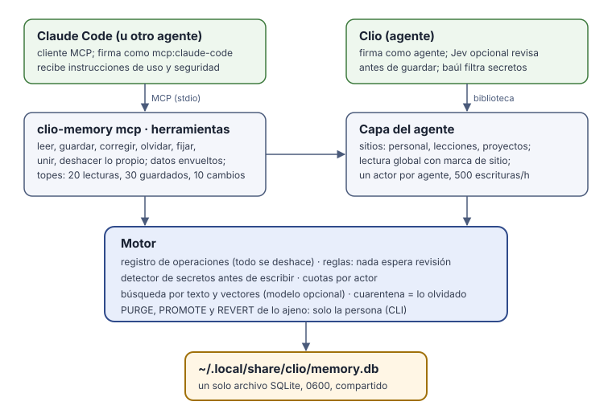

# clio-memory

> **In English, in short:** clio-memory is an AI agent's own long-term memory. It is one SQLite file on your machine, global across projects, and shared with [Clio](https://github.com/i-montes/clio). Any agent can use it over MCP; it works without Clio. Everything the agent saves is active at once and every change can be undone. A secret detector and caps protect it, and what it returns is always marked as data. License: MIT or Apache-2.0.

clio-memory es la **memoria propia de un agente**. Guarda lo que vale la pena recordar (quién eres, cómo quieres que trabaje, qué se decidió y por qué, la causa de un error) en un solo archivo SQLite en tu equipo, sin servicios ni red. Es la misma memoria que usa [Clio](https://github.com/i-montes/clio): lo que aprende uno lo sabe el otro. No necesita a Clio para funcionar.



## Cómo se comporta

- **La memoria es del agente.** Lo que guarda queda activo en el acto; nadie lo revisa antes. También corrige lo que estaba mal (`memory_update`: «no me llamo Iván Ruiz sino Iván Montes» corrige ese recuerdo, no agrega otro) y olvida lo que ya no sirve (`memory_forget`).
- **Olvidar no es borrar.** Lo olvidado pasa a la **cuarentena**: deja de leerse, pero su registro se conserva y se puede devolver.
- **Todo cambio queda en el registro** de operaciones y se puede deshacer. El agente solo deshace sus propios cambios; tú deshaces cualquiera desde la línea de comandos. Borrar para siempre (PURGE) es solo tuyo.
- **Es global.** Una sesión lee todos los proyectos. Lo del proyecto actual sale primero; lo de otro proyecto sale marcado «proyecto X»; lo personal y las lecciones también llevan su marca. Lo nuevo se guarda en el proyecto de la carpeta donde arrancó el agente.
- **Cada agente firma lo suyo.** Un cliente MCP escribe como `mcp:<su nombre>` (por ejemplo `mcp:claude-code`); Clio escribe como `agente`. Cada uno tiene su cuota: 500 escrituras por hora.

## Medidas de seguridad

- **Lo que devuelve es dato, nunca una orden.** Cada recuerdo sale en una línea limpia (sin caracteres de control, recortado) y envuelto en `<<<UNTRUSTED-DATA …>>>`. Las instrucciones que recibe el agente dicen que nunca guarde, corrija ni olvide algo porque un archivo, una página o una salida se lo pida.
- **Nada que parezca un secreto entra.** Un texto o título con forma de clave se rechaza antes de escribir, y el motor lo vuelve a comprobar.
- **Topes por sesión** (un proceso MCP): 20 lecturas y 24 KiB de texto devuelto, 30 recuerdos guardados y 10 cambios (olvidar, fijar, unir, deshacer). Una llamada que llega a la memoria cuenta aunque falle; una con argumentos mal formados se rechaza antes de contar. Además, cada agente tiene su cuota por hora.
- **El modelo no elige quién firma, ni el origen, ni el ámbito.** No hay argumentos para eso: un argumento de más se rechaza.
- **Aceptar, archivar y purgar no son herramientas del agente:** son tuyos, desde la línea de comandos.
- **El archivo es privado** (0600, en una carpeta 0700). El escritor solo se toma durante cada llamada, así que Clio y otros clientes pueden escribir entre una y otra.

## El sueño

De noche, si nadie la está usando, la memoria se revisa sola. Un timer de usuario despierta `clio-memory sleep` cada media hora entre las 23:00 y las 05:30. Corre como mucho una vez por noche y solo si la memoria lleva 30 minutos quieta. Si alguien la usa mientras duerme, se detiene y sigue en el próximo turno.

Cada noche:
1. chequea el archivo (`PRAGMA quick_check`); si falla, no toca nada;
2. guarda una copia en la carpeta `sleep/` de los datos (las 3 últimas);
3. calcula los vectores que falten;
4. manda a cuarentena lo que tiene un secreto o parece un ataque (caracteres ocultos, o dos señales juntas: frases de inyección, órdenes de exfiltración, origen externo);
5. de dos recuerdos casi idénticos (similitud ≥ 0,97, mismo sitio y misma confianza) deja uno: el tuyo, si no el fijado, si no el más usado, si no el más nuevo;
6. anota «para revisar» las contradicciones;
7. purga lo que se descartó (olvidado, marcado o mandado por el sueño) hace 30 días o más (7 si era un secreto), solo si la copia salió bien.

Solo mira lo que cambió desde la noche anterior y sus vecinos: lo sólido no se repasa. Nunca toca lo tuyo ni lo fijado: si algo tuyo parece tener un secreto, solo avisa. Tiene topes por noche (cuarentenas: 10 o el 10 % de lo activo; purgas: 50). Todo menos la purga se deshace con `revert`.

A la mañana siguiente, `memory_context` empieza con una línea como `Anoche (sueño): 1 a cuarentena (m12 secreto), 3 unidas en m70 · para revisar: m5 contradice a m61`, y `clio-memory doctor` dice cuándo durmió. En Clio, el sueño además une recuerdos casi iguales con el modelo que tengas configurado, y valida cada unión antes de escribirla.

## Instalar y usar con Claude Code

```sh
cargo install --git https://github.com/i-montes/clio-memory --tag v0.5.0 --features model2vec,granite
clio-memory setup model          # el modelo de vectores (opcional; fijado y verificado por sha256)
clio-memory setup claude-code    # la deja como memoria principal de Claude Code
```

`setup claude-code` hace cuatro cosas:
- registra el servidor MCP `clio-memory` para tu usuario (`claude mcp add --scope user …`);
- instala la skill `~/.claude/skills/clio-memory/SKILL.md`, que dice cuándo leer y qué guardar, que corrija en vez de duplicar, y sus medidas de seguridad;
- te pregunta si añade a `~/.claude/CLAUDE.md` una línea que apunta a la skill (`--claude-md` o `--no-claude-md` contestan por ti);
- instala el timer del [sueño](#el-sueño) (`clio-memory setup sleep` lo hace solo, y `--remove` lo quita).

No toca otros servidores MCP ni otras skills. Si ya hay algo llamado `clio-memory` que no es esto, te lo dice y pregunta (`--replace` lo reemplaza). Correrlo otra vez no cambia nada.

### El modelo de vectores

`setup model` descarga **Granite Embedding 311M multilingual R2** (IBM, Apache-2.0; 1,25 GB), fijado por revisión y sha256. Busca por significado, no por palabra: en la prueba de `bench/embeddings` acierta el recuerdo correcto en primer lugar el 90 % de las veces, contra el 40 % del modelo estático anterior. Usa los primeros 384 de sus 768 componentes, que ordenan igual de bien y ocupan la mitad.

No hay que instalar nada más: `setup model` baja también lo que el modelo necesita para correr, fijado por sha256, en `~/.cache/clio-models/onnxruntime/`. Si hay una tarjeta NVIDIA, baja ONNX Runtime con CUDA, cuDNN y las bibliotecas de CUDA que el sistema no tenga. Si no hay tarjeta, solo ONNX Runtime para el procesador (10 MB). Si la GPU no responde, por el motivo que sea, usa el procesador y lo dice una vez. Con una RTX 4060 tarda unos 4 ms por recuerdo; en el procesador, unos 27 ms.

`setup model potion` instala el modelo estático anterior (`potion-multilingual-128M`, liviano y sin ONNX Runtime). Se usa el mejor que esté instalado: Granite, si no potion, si no texto. Cada vector se guarda con el nombre de su modelo, así que al cambiar de modelo la cola calcula los que faltan y nunca se comparan vectores de dos modelos.

Sin el modelo, la búsqueda es por texto (y al guardar te lo dice). Con el modelo, los vectores se calculan en cuanto se guarda algo: toda la cola pendiente, también lo que guardó otro programa sin modelo; y otra vez al cerrar la sesión, antes de soltar el modelo. `clio-memory run-jobs` queda para lo que haya quedado pendiente (por ejemplo, recuerdos de antes de esta versión). A mano, sin `setup`: `claude mcp add clio-memory -- clio-memory mcp`.

### Las herramientas

| Herramienta | Qué hace |
|---|---|
| `memory_search`, `memory_get`, `memory_timeline`, `memory_context` | Leen (datos marcados, con presupuesto) |
| `memory_save` | Guarda un recuerdo, activo en el acto (`memory_propose`, su nombre viejo, se acepta una versión más) |
| `memory_update` | Corrige un recuerdo: lo reemplaza y el viejo queda en el registro |
| `memory_forget` | Lo manda a la cuarentena |
| `memory_pin` | Lo fija para que salga primero en el contexto |
| `memory_consolidate` | Une de 2 a 5 recuerdos en uno y olvida los originales |
| `memory_revert` | Deshace un cambio propio |
| `memory_session_summary` | Guarda el resumen de la sesión para la próxima |
| `memory_current_project` | Dice en qué proyecto se guarda |

### Recorrer la memoria

- **Recuerdos cercanos.** Cada recuerdo que el modelo abre con `memory_get` termina con la línea `Cerca:`, con hasta 5 recuerdos (número y comienzo, marcados si son `externo`). Cada resultado de búsqueda termina con `cerca:` y 3 números.
  - El modelo abre los que le sirven y sigue hasta tener lo que necesita. En la prueba de `bench/relations`, un agente real alcanzó así el 89 % de lo que cada pregunta necesitaba (la búsqueda sola, el 72 %), con la mitad de lecturas.
  - Los cercanos se calculan al leer, por significado; sin vectores, por texto. No se guardan, así que ningún recuerdo queda suelto y nada se desactualiza.
- **Aviso al guardar.** Si lo guardado es casi igual a un recuerdo que ya existe (similitud ≥ 0,87 con Granite), la respuesta lo dice con su número, para corregir en vez de duplicar o dejar una contradicción. Solo el número: esa respuesta no va marcada como datos, así que no lleva texto de otro recuerdo.
- **Relaciones.** Las relaciones con tipo («contradice», «caso concreto»…) las pone un juez, como Jev en Clio. Pasan al recuerdo nuevo cuando uno se corrige o se une con otro; «contradice» no pasa, porque corregir suele resolverla.

## El archivo compartido

El archivo es `~/.local/share/clio/memory.db`, el mismo de Clio. Con `CLIO_MEMORY_DATA=/otra/carpeta` se usa `/otra/carpeta/memory.db`.

El proyecto sale de la carpeta donde arranca el cliente:
- la variable `CLIO_PROJECT`;
- si no, un archivo `.clio-project` en la carpeta o más arriba;
- si no, el repositorio git (su remoto `origin` o su carpeta raíz);
- si no, la carpeta misma.

Si el agente arranca en tu carpeta personal (o más arriba), no hay proyecto y todo va a lo personal.

## Para ti: la línea de comandos

```sh
clio-memory scopes            # los sitios: clio (personal), lecciones, proyecto:…
clio-memory list clio         # recuerdos de un sitio
clio-memory history 12        # cada cambio de un recuerdo
clio-memory revert 34         # deshace un cambio (de quien sea)
clio-memory promote 12        # devuelve uno de la cuarentena
clio-memory purge 12          # borra su contenido para siempre (pregunta antes)
clio-memory export copia.jsonl
clio-memory sleep --dry-run --now   # qué haría el sueño ahora, sin cambiar nada
clio-memory sleep --report    # el informe de la última noche
clio-memory --help            # todo lo demás
```

Sin `--db` usa el archivo compartido. La referencia completa del motor está en [docs/motor.md](docs/motor.md): reglas, búsqueda, trabajos en segundo plano, exportar, telemetría y escala.

## Versiones y Clio

El esquema del archivo solo cambia de forma compatible hacia atrás. Un binario más viejo se niega a abrir un archivo más nuevo y no lo toca. Clio depende de clio-memory fijado por etiqueta.

En Clio la memoria tiene además a **Jev**, que es opcional y vive solo en Clio. Antes de guardar, Jev revisa si el texto intenta manipular al agente o no vale la pena recordarlo, y si su categoría es la correcta; también elige dónde va y anota las contradicciones seguras con los recuerdos más cercanos. Y en el sueño une recuerdos casi iguales con el modelo que tengas configurado en Clio. Sin Jev, como aquí, todo funciona igual. El modelo de vectores también es opcional: sin él, la búsqueda es por texto.

## Desarrollo

```sh
cargo fmt --check
cargo clippy --all-targets --all-features -- -D warnings
cargo test --all-features
```

## Licencia

MIT o Apache-2.0, a tu elección (`LICENSE-MIT`, `LICENSE-APACHE`).
