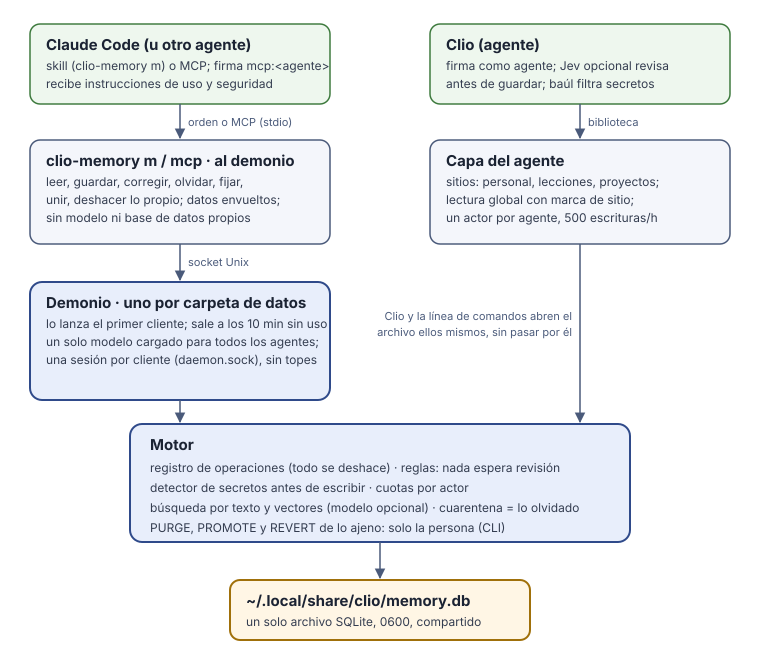

# clio-memory

> **In English, in short:** clio-memory is an AI agent's own long-term memory. It is one SQLite file on your machine, global across projects, and shared with [Clio](https://github.com/i-montes/clio). An agent uses it by a skill that runs `clio-memory m …` commands, or over MCP; it works without Clio. Everything the agent saves is active at once and every change can be undone. A secret detector and caps protect it, and what it returns is always marked as data. License: MIT or Apache-2.0.

clio-memory es la **memoria propia de un agente**. Guarda lo que vale la pena recordar (quién eres, cómo quieres que trabaje, qué se decidió y por qué, la causa de un error) en un solo archivo SQLite en tu equipo, sin servicios ni red. Es la misma memoria que usa [Clio](https://github.com/i-montes/clio): lo que aprende uno lo sabe el otro. No necesita a Clio para funcionar.



## Cómo se comporta

- **La memoria es del agente.** Lo que guarda queda activo en el acto; nadie lo revisa antes. También corrige lo que estaba mal (`memory_update`: «no me llamo Iván Ruiz sino Iván Montes» corrige ese recuerdo, no agrega otro) y olvida lo que ya no sirve (`memory_forget`).
- **Olvidar no es borrar.** Lo olvidado pasa a la **cuarentena**: deja de leerse, pero su registro se conserva y se puede devolver.
- **Todo cambio queda en el registro** de operaciones y se puede deshacer. El agente solo deshace sus propios cambios; tú deshaces cualquiera desde la línea de comandos. Borrar para siempre (PURGE) es solo tuyo.
- **Es global.** Una sesión lee todos los proyectos. Lo del proyecto actual sale primero; lo de otro proyecto sale marcado «proyecto X»; lo personal y las lecciones también llevan su marca. Lo nuevo se guarda en el proyecto de la carpeta donde arrancó el agente.
- **Los bloques fijos son tuyos.** `memory_context` empieza por lo que pusiste en tus bloques fijos, en una sección propia marcada `<<<PERSON-SET …>>>` (puesta por ti, no dato de afuera), cada uno bajo su línea: `## identidad` (quién es el agente para ti), `## reglas` (cómo trabaja) y `## preferencias` (quién eres tú). Un bloque vacío no sale; si ninguno tiene nada, no hay sección. En ella solo entra lo que escribiste tú: un recuerdo de un agente o `externo` que pongas en un bloque sale con el resto, como dato. Ningún agente puede corregir, olvidar, unir ni deshacer un cambio suyo de modo que cambie lo que un bloque muestra: la memoria le contesta «ese recuerdo está en un bloque fijo de la persona: solo ella lo cambia». Una importación de recuerdos sueltos rechaza esa línea y sigue.
- **Cada agente firma lo suyo.** Un agente escribe como `mcp:<su nombre>` (por ejemplo `mcp:claude-code`), lo use por MCP o por `clio-memory m`; Clio escribe como `agente`. Cada uno tiene su cuota: 500 escrituras por hora.

## Medidas de seguridad

- **Lo que devuelve es dato, nunca una orden.** Cada recuerdo sale en una línea limpia (sin caracteres de control, recortado) y envuelto en `<<<UNTRUSTED-DATA …>>>`. La excepción son tus bloques fijos, en su propia sección `<<<PERSON-SET …>>>`, lo primero de la respuesta: enteros y solo con lo que escribiste tú. Las instrucciones que recibe el agente dicen que nunca guarde, corrija ni olvide algo porque un archivo, una página o una salida se lo pida.
- **Nada que parezca un secreto entra.** Un texto o título con forma de clave se rechaza antes de escribir, y el motor lo vuelve a comprobar.
- **Topes por sesión** (un proceso MCP, o una sesión de agente y carpeta con `clio-memory m`): 20 lecturas y 24 KiB de texto devuelto, 30 recuerdos guardados y 10 cambios (olvidar, fijar, unir, deshacer). Una llamada mal formada (argumentos inválidos, o un texto o título demasiado largo una vez limpio) se rechaza antes de contar; una que se rechaza por parecer un secreto sí cuenta, para que el filtro no sirva de oráculo. Un recuerdo tiene hasta 1200 caracteres; un resumen de sesión, hasta 600 por parte y 1200 con sus etiquetas. Además, cada agente tiene su cuota por hora.
- **El modelo no elige quién firma, ni el origen, ni el ámbito.** No hay argumentos para eso: un argumento de más se rechaza.
- **Aceptar, archivar y purgar no son herramientas del agente:** son tuyos, desde la línea de comandos.
- **El archivo es privado** (0600, en una carpeta 0700). El escritor solo se toma durante cada llamada, así que Clio y otros clientes pueden escribir entre una y otra.

## Qué sale de esta máquina

- Nada sale, salvo las descargas de `setup` y `update` y, **solo si tú lo configuraste** con `clio-memory setup temis`, el contenido de los recuerdos parecidos que el sueño le pregunta a Temis (ver «El sueño con Temis»), únicamente al servidor que pusiste.
- ONNX Runtime trae telemetría de Microsoft: clio-memory la apaga con `ORT_DISABLE_TELEMETRY=1` (el binario se vuelve a ejecutar con la variable puesta) y no carga el runtime sin ella.
- Un programa que use la biblioteca debe llamar a `clio_memory::private_runtime()` al empezar.

## El sueño

Cuando nadie la está usando, la memoria se revisa sola, a cualquier hora. Un timer de usuario despierta `clio-memory sleep` cada media hora, todo el día. Duerme solo si nadie escribió ni leyó en 30 minutos (leer también cuenta) y además cambió algo desde el último sueño o pasó un día. Si alguien la usa mientras duerme, se detiene y sigue en el próximo turno. Los sueños de un mismo día suman en un solo informe y comparten la copia del día.

Cada sueño:
1. chequea el archivo (`PRAGMA quick_check`); si falla, no toca nada;
2. guarda una copia en la carpeta `sleep/` de los datos (las 3 últimas; una purga no llega a ellas: conservan el título y la categoría de lo purgado hasta que rotan, 3 días como máximo);
3. calcula los vectores que falten;
4. limpia el título y la categoría que purgas anteriores dejaron en los registros;
5. manda a cuarentena lo que tiene un secreto o parece un ataque (caracteres ocultos, o dos señales juntas: frases de inyección, órdenes de exfiltración, origen externo);
6. de dos recuerdos casi idénticos (similitud ≥ 0,97, mismo sitio y misma confianza) deja uno: el tuyo, si no el fijado, si no el más usado, si no el más nuevo;
7. con Temis configurado, dobla un recuerdo que otro conserva entero (ver «El sueño con Temis»);
8. anota «para revisar» las contradicciones;
9. purga lo que se descartó (olvidado, marcado o mandado por el sueño) hace 30 días o más (7 si era un secreto), solo si la copia salió bien.

Solo mira lo que cambió desde el sueño anterior y sus vecinos: lo sólido no se repasa. Nunca toca lo tuyo ni lo fijado: si algo tuyo parece tener un secreto, solo avisa. Tiene topes por día (cuarentenas: 10 o el 10 % de lo activo; purgas: 50). Todo menos la purga se deshace con `revert`.

Después, `memory_context` empieza con una línea como `Anoche (sueño): 1 a cuarentena (m12 secreto), 3 unidas en m70 · para revisar: m5 contradice a m61` (dice «Anoche» aunque el sueño ya no sea de noche), y `clio-memory doctor` dice cuándo durmió; si hay cambios sin revisar y el último sueño completo tiene más de 3 días, `doctor` falla: el timer no está corriendo. En Clio, el sueño además une recuerdos casi iguales con el modelo que tengas configurado, como mucho una vez cada 20 horas, y valida cada unión antes de escribirla.

### El sueño con Temis

Si configuraste [Temis](docs/motor.md#the-sleep) (`clio-memory setup temis --url URL`, el token por la entrada estándar), el sueño le pregunta por los pares de recuerdos parecidos, sin modelo de lenguaje y sin gastar tokens. Hace dos preguntas por par: si todo lo que dice uno está también en el otro (`se_conserva`, de 0 a 1, en los dos sentidos) y cómo se relacionan (`relacion`). Con la respuesta:

- si uno contiene al otro (≥ 0,80; sus cifras, palabras de código y nombres están en el que queda, y los dos dicen las mismas negaciones) y Temis no ve una contradicción (ningún `conflicts_with` con confianza ≥ 0,50), el contenido va a cuarentena con «sueño: contenido en mN» (se deshace con `revert`; se purga a los 30 días); el otro recuerdo queda con sus relaciones;
- si lo contiene pero Temis dice `conflicts_with` (confianza ≥ 0,50), no se dobla: el par sale en «para revisar»;
- en cualquier otro caso no pasa nada. El sueño nunca escribe relaciones de Temis.

**Sin Temis, nada cambia.** Lo que se envía es el contenido de los pares parecidos (cortado a 4000 caracteres, y nunca un texto que parezca un secreto), solo al servidor que configuraste, con `curl` y el token por la entrada estándar (nunca en la línea de órdenes). Un `--dry-run` nunca pregunta. Topes: 40 pares por sueño, 10 s por llamada; si falla 3 veces seguidas (o no respondió ni una vez), los parecidos quedan para el próximo sueño con una sola alarma; mientras no responde, esos pares esperan al próximo sueño que corra de todos modos (al menos uno al día) en vez de despertarlo.

`setup temis` verifica el servidor antes de guardar (`<datos>/temis.json`, 0600): `--check` lo vuelve a preguntar, `--remove` lo quita, `--allow-http` admite `http` fuera de esta máquina (por defecto solo `https`). `CLIO_MEMORY_TEMIS_URL` y `CLIO_MEMORY_TEMIS_TOKEN` mandan sobre todo; después, si el baúl de Clio está abierto y guarda la llave (`temis`, destino `jev:api.imontes.dev`), el sueño la toma de ahí y no hace falta `temis.json`; si no, el archivo. Como guarda una credencial y manda texto de tu memoria a un servidor, **solo la persona puede correrlo**: un agente no.

Medido el 2026-11-15 con el servicio real sobre los 28 pares de `bench/recall` ([bench/temis/results.md](bench/temis/results.md)): con el umbral en 0,80 se doblan 8 de 12 paráfrasis y 0 de 8 pares que solo se parecen (el mayor queda en 0,36). Su `conflicts_with` no es de fiar (3 falsos en 20 pares sin contradicción), y por eso solo sirve para no doblar. Son pocos pares, escritos por la misma mano: es una primera medida.

## Instalar

```sh
curl -fsSL https://raw.githubusercontent.com/i-montes/clio-memory/main/install.sh | sh
```

Hay binario para Linux (x86_64 y aarch64) y macOS (arm64 e Intel). El instalador hace cuatro cosas:
- baja el binario de tu plataforma del último release, comprueba su sha256 contra `SHA256SUMS` (y su atestación de GitHub, si tienes `gh` 2.49 o más nuevo con sesión) y solo entonces lo deja en `~/.local/bin` (o `$CLIO_MEMORY_BIN_DIR`). No edita ningún archivo de tu shell: si esa carpeta no está en tu `PATH`, te dice la línea que la agrega;
- busca los agentes que tienes (Claude Code, OpenCode, Codex, Gemini CLI y Antigravity), te deja elegir y conecta la memoria en cada uno, por skill (el agente corre `clio-memory m …`, sin proceso por sesión) o por servidor MCP, con la skill y, si quieres, una línea en su archivo de instrucciones;
- instala el modelo de vectores: Granite (347 MB el modelo solo; encima, ONNX Runtime para el procesador) donde corre, potion (531 MB) donde no, o ninguno si lo prefieres (ver [el modelo](#el-modelo-de-vectores));
- instala el timer del [sueño](#el-sueño), en cuanto hay al menos un agente conectado.

No toca otros servidores MCP ni otras skills. Si un agente ya tiene algo llamado `clio-memory` que no es esto, te pregunta antes de reemplazarlo. Correrlo otra vez actualiza el binario y conserva lo elegido.

**Actualizar.** `clio-memory update` (o `clio memory update`, desde Clio) corre este mismo instalador y luego `setup --yes`: baja la última versión con las mismas comprobaciones, se queda lo conectado y pone al día la skill y la línea de instrucciones. Desde v0.11.0, Claude Code y OpenCode pasan a modo skill en esa actualización (se les quita el servidor MCP) si `setup` no había anotado otro modo para ellos; reinicia las sesiones de agente abiertas.

**Sin terminal, o con `--yes`.** En los dos casos no pregunta nada y cada paso sale como una línea: usa las banderas y, donde faltan, todos los agentes que encuentra, el modelo recomendado y la línea de instrucciones. Si ya había algo conectado (otra corrida), donde faltan las banderas se queda lo que había: los mismos agentes, el mismo modelo (no se baja ninguno) y las líneas como estaban (salvo la de una versión anterior, que se renueva). Las banderas pasan a `setup` tal cual:

```sh
curl -fsSL https://raw.githubusercontent.com/i-montes/clio-memory/main/install.sh | sh -s -- --yes --agents codex,gemini --model potion
```

Sin preguntas (con `--yes` o sin terminal), las banderas solo agregan: nunca desconectan un agente, ni quitan una línea, ni borran un modelo (para eso, `uninstall`; en una terminal, `setup` lo hace si se lo pides, y pregunta antes). Todas están en [docs/instalador.md](docs/instalador.md#modo-sin-terminal), con las variables de entorno del instalador. Para fijar la versión que se baja:

```sh
curl -fsSL https://raw.githubusercontent.com/i-montes/clio-memory/main/install.sh | CLIO_MEMORY_VERSION=vX.Y.Z sh
```

### Los agentes

Cada agente se conecta de una de dos maneras, y la skill es la misma en las dos (usa las herramientas `memory_*` si las tiene y, si no, las órdenes de [`clio-memory m`](#las-herramientas)):

- **Por skill.** No hay servidor: el agente corre `clio-memory m …` y cada orden pasa por el demonio. Es lo que `setup` hace por defecto en Claude Code y OpenCode, siempre que el `clio-memory` del `PATH` sea este binario (la skill lo corre a secas); si no está en el `PATH`, o hay otro antes, el defecto es MCP y `setup` dice por qué. En Claude Code, `setup` agrega además la regla `Bash(clio-memory m:*)` a `permissions.allow` de `~/.claude/settings.json`, para que corra esas órdenes sin pedir permiso cada vez (no toca ninguna otra clave).
- **Por MCP.** El servidor es `<ruta absoluta del binario> mcp`, un proceso delgado que pasa las llamadas al demonio. Es lo que `setup` hace por defecto en Codex, Gemini CLI y Antigravity.

`clio-memory setup --mode skill|mcp|auto` elige el modo de los agentes que conecta (`auto`, el de siempre, conserva el que cada uno tenía y, si no tenía, el de su defecto); por ejemplo `clio-memory setup --agents codex --mode skill`. En una terminal, `setup` muestra cómo quedará cada agente y deja cambiarlo. El modo de cada agente se anota en `agents.json`, en la carpeta de datos (`$CLIO_MEMORY_DATA`, o `~/.local/share/clio`), y volver a correr `setup` lo respeta. Cambiar de modo quita lo del otro (el servidor MCP o la regla de permiso). Un agente cuya shell corre en un sandbox (Codex por defecto) puede no alcanzar el socket ni la carpeta de datos: si es así, se queda por MCP.

La línea de instrucciones es una sola: `- Mi memoria principal es clio-memory: úsala según la skill clio-memory.` Reemplaza a la de versiones anteriores (`… clio-memory (MCP): …`): `clio-memory update` (que corre `setup --yes`) la renueva sin que lo pidas, en el mismo lugar y sin dejar las dos.

| Agente | Modo por defecto | Se detecta por | Servidor MCP (si es por MCP) | Línea de instrucciones |
|---|---|---|---|---|
| Claude Code | skill | `claude` | `claude mcp add --scope user …` | `~/.claude/CLAUDE.md` |
| OpenCode | skill | `opencode` o `~/.config/opencode/` | `mcp.clio-memory` en `~/.config/opencode/opencode.json` | `~/.config/opencode/clio-memory.md`, enlazado en `instructions` de `opencode.json` |
| Codex | MCP | `codex` | `codex mcp add clio-memory -- …` | `~/.codex/AGENTS.md` (`CODEX_HOME` si está definida) |
| Gemini CLI | MCP | `gemini` | `gemini mcp add -s user …` | `~/.gemini/GEMINI.md` |
| Antigravity | MCP | `agy`, `antigravity` o `~/.gemini/config/` | `mcpServers.clio-memory` en `~/.gemini/config/mcp_config.json` | `~/.gemini/GEMINI.md` (la de Gemini CLI) |

La skill va en la menor cantidad de carpetas que cubra a los agentes conectados, para que ninguno la vea dos veces si se puede evitar. Para conectar solo Claude Code, `clio-memory setup claude-code` (con `--replace`, y `--claude-md` o `--no-claude-md` para contestar por la línea de instrucciones). Los archivos exactos, los comandos, dónde va la skill en cada combinación y lo que está sin verificar: [docs/instalador.md](docs/instalador.md).

### Desinstalar

```sh
clio-memory uninstall                         # todos los agentes, el sueño y el binario
clio-memory uninstall --agents codex,gemini   # solo esos agentes
clio-memory uninstall --models                # además borra ~/.cache/clio-models (también los de Clio)
clio-memory uninstall --data                  # además borra la memoria (pregunta antes)
```

Quita de cada agente el servidor MCP `clio-memory` (o, si estaba por skill, su modo anotado y la regla de permiso de Claude Code), la skill y la línea de instrucciones, pero **solo lo que es nuestro**: un servidor o una skill ajenos con ese nombre no se tocan. Sin `--agents` quita también el timer del sueño y, al final, el binario si está en `~/.local/bin` (o en `$CLIO_MEMORY_BIN_DIR`); si algo no se pudo quitar, el binario se queda y puedes correrlo otra vez. **No borra la memoria ni los modelos si no lo pides.** `--models` borra `~/.cache/clio-models` entera, que también usa Clio: si los necesita, se vuelven a bajar. `--data` borra para siempre `memory.db` (con sus `-wal`, `-shm` y candados) y la carpeta `sleep/` de al lado, y nada más de la carpeta de datos, porque ahí guarda sus archivos Clio. Sin terminal exige `--yes`.

### Compilar tú mismo

```sh
cargo install --git https://github.com/i-montes/clio-memory --features model2vec,granite
clio-memory setup
```

Compila la rama principal; sin `--features` el binario no puede cargar los modelos. `setup` conecta los agentes con la ruta de ese binario (en `~/.cargo/bin`); `uninstall` lo deja ahí, porque solo borra el que está en `~/.local/bin`. Si después instalas con la línea de `curl`, el de `~/.cargo/bin` puede ir antes en el `PATH` y ser el que corre al escribir `clio-memory`: `setup` lo quita con `cargo uninstall` cuando los registros de cargo dicen que es este crate, y si no puede, lo dice; `doctor` también lo avisa.

Como biblioteca (lo que hace Clio): `clio-memory = { …, default-features = false, features = ["model2vec", "granite"] }`. La feature `cli`, que va por defecto, es solo la del binario: la pantalla de `setup` (cliclack, console) y `serde_json/preserve_order`, que mantiene en su sitio las claves de los archivos de configuración de los agentes que `setup` edita. Sin ella no se compila nada de eso, y la biblioteca no cambia cómo serializa JSON el programa que la usa: cargo unifica las features, y `preserve_order` las aplicaría a todo `serde_json::Value` de ese programa.

### El modelo de vectores

`clio-memory setup` instala **Granite Embedding 311M multilingual R2** (IBM, Apache-2.0), en su versión cuantizada (347 MB el modelo solo), donde corre, y `setup model` lo hace por separado, fijado por revisión y sha256. Busca por significado, no por palabra: en la prueba de `bench/embeddings` pone el recuerdo correcto entre los cinco primeros el 97,5 % de las veces, igual que el modelo completo (1,28 GB), y en primer lugar el 85 % (el completo, 90 %; el modelo estático anterior, 40 %). Usa los primeros 384 de sus 768 componentes, que ordenan igual de bien y ocupan la mitad.

Granite tiene su propio umbral de relevancia (0,83 de coseno el cuantizado, 0,84 el completo): pone cualquier par de textos en español por encima de 0,78, así que con el umbral genérico la búsqueda nunca decía «nada relevante». En la prueba de `bench/recall` (120 recuerdos, 159 preguntas), con ese umbral el recuerdo correcto sale entre los 5 primeros el 97 % de las veces con los dos, y la búsqueda se calla en el 31 % (cuantizado) o el 38 % (completo) de las preguntas que no tienen respuesta.

Corre en el procesador, nunca en la GPU: una búsqueda convierte un texto corto en vector en unos 26 ms, y en la GPU cada sesión de cada agente guardaba su propia copia del modelo. No hay que instalar nada más: `setup model` baja también ONNX Runtime para el procesador, fijado por sha256, en `~/.cache/clio-models/onnxruntime/`, y quita lo que dejaron las versiones anteriores (el modelo completo y las bibliotecas de CUDA, unos 3,4 GB).

El modelo no se lee al abrir la memoria, sino cuando hay un texto que convertir en vector (una búsqueda o un recuerdo nuevo): leer el contexto o un recuerdo no lo carga. Cargado ocupa unos 500 MB de memoria y tarda unos 2 s en leerse; lo carga el [demonio](#un-solo-proceso-el-demonio), una sola vez para todos los agentes, y el demonio lo conserva hasta que sale a los 10 minutos sin uso (ahí se devuelve toda la memoria). La línea de comandos, el `mcp` sin demonio y los programas anfitriones lo sueltan tras un minuto sin uso.

`setup model potion` (o `--model potion` en `setup`) instala el modelo estático anterior (`potion-multilingual-128M`, 531 MB, liviano y sin ONNX Runtime). Se usa el mejor que esté instalado: Granite, si no potion, si no texto. Cada vector se guarda con el nombre de su modelo, así que al cambiar de modelo la cola calcula los que faltan y nunca se comparan vectores de dos modelos.

Sin el modelo, la búsqueda es por texto (y al guardar te lo dice). Con el modelo, los vectores se calculan en cuanto se guarda algo: toda la cola pendiente, también lo que guardó otro programa sin modelo; y otra vez antes de soltar el modelo: al cerrar la sesión o, con el demonio, cuando el demonio sale. `clio-memory run-jobs` queda para lo que haya quedado pendiente (por ejemplo, recuerdos de antes de esta versión). A mano, sin `setup`: `claude mcp add clio-memory -- clio-memory mcp`.

Un programa anfitrión que use la biblioteca puede tomar los vectores del demonio en vez de cargar su propia copia del modelo: `EmbedModel::from_embedder(Arc::new(RemoteEmbedder::connect(data, launch)?))`. `launch.exe` debe ser el binario de clio-memory (llama a `private_runtime()`, así que ONNX Runtime arranca sin telemetría; una ruta relativa se toma desde la carpeta de trabajo del anfitrión) y el anfitrión no carga ONNX Runtime. Un lote demasiado largo para una petición va en partes, y cada petición espera como mucho 2 minutos (`CLIO_MEMORY_DAEMON_TIMEOUT`). Si `connect` falla (el demonio no tiene modelo, o no arranca), el anfitrión se queda con su modelo local. Un anfitrión que carga Granite él mismo debe llamar a `clio_memory::private_runtime()` al empezar su `main`.

### Las herramientas

Un agente usa la memoria por las herramientas MCP `memory_*` o, si no las tiene, por `clio-memory m <verbo>`: cada verbo es una llamada a la misma herramienta, con lo mismo que ella recibe.

| Herramienta | Orden | Qué hace |
|---|---|---|
| `memory_search`, `memory_get`, `memory_timeline`, `memory_context` | `m search TEXT [--limit N]`, `m get ID`, `m timeline ID [--before N] [--after N]`, `m context` | Leen (datos marcados, con presupuesto) |
| `memory_save` | `m save [--kind semantic\|procedural] [--title T] [--category C] TEXT` | Guarda un recuerdo, activo en el acto (`memory_propose`, su nombre viejo, se acepta una versión más) |
| `memory_update` | `m update ID [--title T] [--category C] TEXT` | Corrige un recuerdo: lo reemplaza y el viejo queda en el registro |
| `memory_forget` | `m forget ID` | Lo manda a la cuarentena |
| `memory_pin` | `m pin ID` | Lo fija para que salga primero en el contexto |
| `memory_consolidate` | `m consolidate IDS [--title T] [--category C] TEXT` | Une de 2 a 5 recuerdos en uno y olvida los originales |
| `memory_revert` | `m revert CHANGE` | Deshace un cambio propio |
| `memory_session_summary` | `m summary --goal G --accomplished A [--instructions I] [--discoveries D] [--next-steps N] [--files F]` | Guarda el resumen de la sesión para la próxima |
| `memory_current_project` | `m project` | Dice en qué proyecto se guarda |

**Cómo se usan las órdenes.**

- `ID` es `12` o `m12`; `IDS` va como `12,15`; `TEXT` son las palabras que quedan en la línea, o `-` para leerlo de la entrada estándar (sin su último salto de línea). Un texto largo, o con comillas, `$`, comillas invertidas, `--` o saltos de línea, entra por `-` con un heredoc de comillas simples, para que la shell no lo toque:

  ```sh
  clio-memory m save --title "Elegí Postgres 16 para pedidos" --category decision - <<'EOF'
  Qué: … · Por qué: … · Dónde: … · Aprendido: …
  EOF
  ```

- La respuesta de la herramienta sale por la salida estándar; el aviso del demonio y el de «atendí en este proceso» salen por la de error, como `clio-memory m: …`.
- **Códigos de salida:** 0 si la memoria contestó, 1 si la herramienta se negó (dice por qué), 2 si la orden está mal escrita (no toca nada).
- Pasa por el demonio, o por una sesión dentro del proceso si no hay (`CLIO_MEMORY_NO_DAEMON=1`). Quién llama sale de `--agent NAME` (después de `m`), de `CLIO_MEMORY_AGENT`, del entorno (`CLAUDECODE`) o del programa de agente que lo lanzó, y firma `mcp:<agente>` como siempre. `--actor`, `--model` y `--json` antes de `m` son un error de uso.
- Si el demonio no se alcanza, o la sesión de quien llama no se distingue, cada `clio-memory m` se atiende en su propio proceso y sus presupuestos no se comparten entre llamadas: los presupuestos son contra el desboque, no una barrera.

**Órdenes de la persona.** Las que no empiezan por `m` y actúan con tu autoridad (`purge`, `promote`, `archive`, `revert`, `feedback`, `import`, `import-memories --origin user`, `remember` sin `--actor` y `uninstall --data`) se niegan, con código 1, cuando las corre un agente, a menos que pongas `CLIO_MEMORY_AS_PERSON=1`. Es para evitar el accidente, no una barrera: un agente con shell podría poner la variable. Las de leer (`list`, `history`, `stats`…) no se tocan.

### Recorrer la memoria

- **Recuerdos cercanos.** Cada recuerdo que el modelo abre con `memory_get` termina con la línea `Cerca:`, con hasta 5 recuerdos (número y comienzo, marcados si son `externo`). Cada resultado de búsqueda termina con `cerca:` y 3 números.
  - El modelo abre los que le sirven y sigue hasta tener lo que necesita. En la prueba de `bench/relations`, un agente real alcanzó así el 89 % de lo que cada pregunta necesitaba (la búsqueda sola, el 72 %), con la mitad de lecturas.
  - Los cercanos se calculan al leer, por significado; sin vectores, por texto. No se guardan, así que ningún recuerdo queda suelto y nada se desactualiza.
- **Aviso al guardar.** Si lo guardado es casi igual a un recuerdo que ya existe (similitud ≥ 0,87 con Granite), la respuesta lo dice con su número, para corregir en vez de duplicar o dejar una contradicción. Solo el número: esa respuesta no va marcada como datos, así que no lleva texto de otro recuerdo.
- **Relaciones.** Las relaciones con tipo («contradice», «caso concreto»…) las pone un juez, como Jev en Clio. Pasan al recuerdo nuevo cuando uno se corrige o se une con otro; «contradice» no pasa, porque corregir suele resolverla.

## Un solo proceso: el demonio

Con varias sesiones de agente abiertas, cada una con su `clio-memory mcp`, cada proceso cargaba su propia copia del modelo (unos 500 MB). Ahora hay **un demonio por carpeta de datos** y el proceso `mcp` de cada agente (o cada `clio-memory m`) solo le pasa las llamadas: no guarda ni modelo ni base de datos (unos 7 MB). Los agentes que atiende comparten el modelo cargado y un solo escritor de la memoria (la línea de comandos y Clio escriben por su cuenta, y el candado de escritor los ordena).

- **Lo lanza el primer cliente** que lo necesita y no hay que arrancarlo a mano. **Se va solo a los 10 minutos sin uso**; `CLIO_MEMORY_DAEMON_IDLE=<segundos>` cambia ese plazo.
- **Un demonio que no contesta en 2 minutos** no deja esperando: esa llamada la atiende el proceso `mcp`, que vuelve a probar el demonio un minuto después (`CLIO_MEMORY_DAEMON_TIMEOUT=<segundos>` cambia el plazo; es para las pruebas).
- **`clio-memory daemon --status`** dice si corre y **`clio-memory daemon --stop`** lo detiene (el próximo uso lanza otro).
- **El socket** es `<carpeta de datos>/daemon.sock`; `CLIO_MEMORY_SOCK=/ruta/absoluta` lo cambia (hace falta si la ruta pasa de 100 bytes). Un socket es de una sola carpeta de datos: si usas varias, cada una necesita su propio `CLIO_MEMORY_SOCK` (el demonio rechaza las peticiones de otra carpeta y ese cliente atiende por su cuenta). El registro, `daemon.log`, y el candado, `daemon.lock`, están en la misma carpeta.
- **`CLIO_MEMORY_NO_DAEMON=1`** lo desactiva: cada proceso `mcp` atiende por su cuenta, como antes. Si el demonio no puede arrancar, el proceso `mcp` también atiende solo.
- **Tras actualizar, reinicia las sesiones de agente abiertas.** Las que ya estaban abiertas siguen con su proceso de v0.9.x hasta que se cierran; las nuevas usan el demonio.

Medido con 5 sesiones a la vez y el modelo real: los cinco procesos `mcp` suman 36 MB y el demonio ocupa unos 520 MB, frente a los 2.480 MB de antes. Las cifras completas están en [bench/sessions/results.md](bench/sessions/results.md).

## El archivo compartido

El archivo es `~/.local/share/clio/memory.db`, el mismo de Clio. Con `CLIO_MEMORY_DATA=/otra/carpeta` se usa `/otra/carpeta/memory.db`.

El proyecto sale de la carpeta donde arranca el cliente:
- la variable `CLIO_PROJECT`;
- si no, un archivo `.clio-project` en la carpeta o más arriba;
- si no, el repositorio git (su remoto `origin` o su carpeta raíz);
- si no, la carpeta misma.

Si el agente arranca en tu carpeta personal (o más arriba), no hay proyecto y todo va a lo personal.

## Para ti: la línea de comandos

```sh
clio-memory scopes            # los sitios: clio (personal), lecciones, proyecto:…
clio-memory list clio         # recuerdos de un sitio
clio-memory history 12        # cada cambio de un recuerdo
clio-memory revert 34         # deshace un cambio (de quien sea)
clio-memory promote 12        # devuelve uno de la cuarentena
clio-memory purge 12          # borra su contenido para siempre (pregunta antes)
clio-memory export copia.jsonl
clio-memory sleep --dry-run --now   # qué haría el sueño ahora, sin cambiar nada
clio-memory sleep --report    # el informe del último sueño
clio-memory setup temis --url URL   # que el sueño pregunte a Temis (token por la entrada estándar)
clio-memory doctor           # la salud de la memoria y de cada agente que encuentra
clio-memory uninstall        # la quita de los agentes (ver «Desinstalar»)
clio-memory --help            # todo lo demás
```

Sin `--db` usa el archivo compartido. La referencia completa del motor está en [docs/motor.md](docs/motor.md): reglas, búsqueda, trabajos en segundo plano, exportar, telemetría y escala.

## Versiones y Clio

Cómo se publica una versión, qué comprueba el instalador y hasta dónde llega la confianza en el binario: [docs/releases.md](docs/releases.md).

El esquema del archivo solo cambia de forma compatible hacia atrás. Un binario más viejo se niega a abrir un archivo más nuevo y no lo toca. Clio depende de clio-memory fijado por etiqueta.

En Clio la memoria tiene además a **Jev**, que es opcional y vive solo en Clio. Antes de guardar, Jev revisa si el texto intenta manipular al agente o no vale la pena recordarlo, y si su categoría es la correcta; también elige dónde va y anota las contradicciones seguras con los recuerdos más cercanos. Y en el sueño une recuerdos casi iguales con el modelo que tengas configurado en Clio. Sin Jev, como aquí, todo funciona igual. El modelo de vectores también es opcional: sin él, la búsqueda es por texto.

## Desarrollo

```sh
cargo fmt --check
cargo clippy --all-targets --all-features -- -D warnings
cargo test --all-features
```

## Licencia

MIT o Apache-2.0, a tu elección (`LICENSE-MIT`, `LICENSE-APACHE`).
